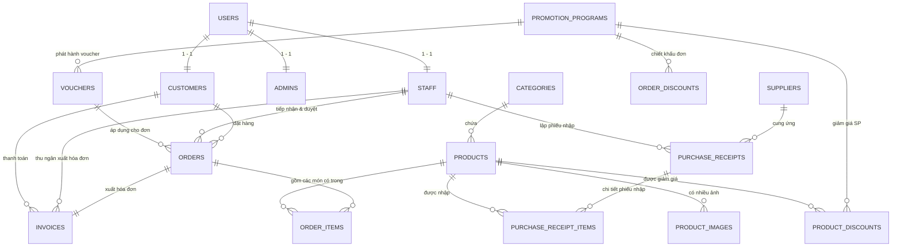

# TÀI LIỆU 00: KIẾN TRÚC HỆ THỐNG VÀ CƠ SỞ DỮ LIỆU
## MÔ HÌNH MVC VÀ BỔ SUNG CƠ SỞ DỮ LIỆU BỘ ADMIN

[⬅️ Quay lại Trang Mục Lục](README.md)

---

## 1. TỔNG QUAN KIẾN TRÚC THEO MÔ HÌNH MVC

Hệ thống quản trị cửa hàng nội thất áp dụng mô hình kiến trúc chuẩn **MVC (Model - View - Controller)** kết hợp các mẫu thiết kế của Spring Boot và React SPA:

```
+-------------------------------------------------------------------------+
|                           VIEW (GIAO DIỆN)                              |
|  - Giao diện Admin xây dựng bằng React SPA (Vite) / Admin Templates     |
|  - Tổ chức component rõ ràng: Sidebar, Header, DataTable, Form, Modals   |
|  - Giao tiếp với Controller thông qua REST APIs (Axios / Fetch)         |
+------------------------------------+------------------------------------+
                                     | JSON Request / Response
                                     v
+-------------------------------------------------------------------------+
|                       CONTROLLER (ĐIỀU KHIỂN)                           |
|  - Các Spring Boot RestController (@RestController) tại /api/admin/**   |
|  - Tiếp nhận Request, xác thực Token JWT và phân quyền vai trò (RBAC)   |
|  - Kiểm tra tính hợp lệ của dữ liệu đầu vào bằng Bean Validation (@Valid)|
|  - Trả về mã phản hồi HTTP chuẩn (200, 201, 400, 401, 403, 404, 500)    |
+------------------------------------+------------------------------------+
                                     | Gọi hàm Service DTO
                                     v
+-------------------------------------------------------------------------+
|                        SERVICE (NGHIỆP VỤ)                              |
|  - Xử lý toàn bộ logic nghiệp vụ (Business Logic)                       |
|  - Tính toán chiết khấu khuyến mãi, kiểm tra điều kiện áp voucher       |
|  - Đảm bảo tính toàn vẹn giao dịch (@Transactional)                     |
|  - Chuyển đổi dữ liệu Entity <-> DTO (Data Transfer Object)             |
+------------------------------------+------------------------------------+
                                     | ORM Query
                                     v
+-------------------------------------------------------------------------+
|                        MODEL (DỮ LIỆU & ORM)                            |
|  - JPA Entities: Ánh xạ 1:1 các bảng trong PostgreSQL                   |
|  - Spring Data JPA Repositories: CRUD, Custom HQL & Native Queries      |
|  - Request / Response DTOs, Validation Models                           |
+-------------------------------------------------------------------------+
```

---

## 2. SƠ ĐỒ QUAN HỆ THỰC THỂ (EXPANDED ERD)

Dưới đây là sơ đồ Mermaid thể hiện mối quan hệ giữa các bảng trong hệ thống quản trị, bao gồm các bảng hiện có từ `database/sales.sql` và 2 bảng mới được mở rộng (`product_images` và `invoices`):



---

## 3. DANH SÁCH CÁC BẢNG TRONG HỆ THỐNG

| STT | Tên Bảng | Mô tả | Trạng thái |
| :---: | :--- | :--- | :---: |
| 1 | `users` | Tài khoản đăng nhập chung (`id`, `username`, `password_hash`, `role`, `is_active`) | Có sẵn |
| 2 | `customers` | Thông tin hồ sơ khách hàng (`user_id`, `full_name`, `email`, `phone`, `address`) | Có sẵn |
| 3 | `staff` | Thông tin hồ sơ nhân viên (`user_id`, `full_name`, `email`, `phone`, `address`) | Có sẵn |
| 4 | `admins` | Thông tin hồ sơ quản trị viên tối cao | Có sẵn |
| 5 | `categories` | Phân loại sản phẩm nội thất (`name`, `description`) | Có sẵn |
| 6 | `products` | Thông tin hàng hóa (`name`, `category_id`, `unit`, `selling_price`, `quantity`, `is_active`) | Có sẵn |
| 7 | **`product_images`** | **Bộ sưu tập nhiều hình ảnh góc chụp cho sản phẩm nội thất (Bổ sung mới)** | **Tạo mới** |
| 8 | `suppliers` | Nhà cung ứng nguyên vật liệu / xưởng gia công nội thất | Có sẵn |
| 9 | `purchase_receipts` | Phiếu nhập kho hàng từ nhà cung cấp | Có sẵn |
| 10 | `purchase_receipt_items` | Chi tiết số lượng và đơn giá nhập hàng theo sản phẩm | Có sẵn |
| 11 | `promotion_programs` | Chiến dịch khuyến mãi (`name`, `start_date`, `end_date`, `status`) | Có sẵn |
| 12 | `product_discounts` | Giảm giá theo sản phẩm (`promotion_program_id`, `product_id`, `discount_percent`) | Có sẵn |
| 13 | `order_discounts` | Chiết khấu theo bậc đơn hàng (`minimum_amount`, `discount_percent`) | Có sẵn |
| 14 | `vouchers` | Mã quà tặng giảm giá (`code`, `discount_percent`, `maximum_discount`, `quantity`) | Có sẵn |
| 15 | `orders` | Đơn đặt hàng của khách (`customer_id`, `staff_id`, `status`, `total_amount`, `discount_amount`) | Có sẵn |
| 16 | `order_items` | Chi tiết từng sản phẩm trong đơn đặt hàng | Có sẵn |
| 17 | **`invoices`** | **Hóa đơn tài chính, thanh toán, thuế VAT, phương thức thanh toán (Bổ sung mới)** | **Tạo mới** |

---

## 4. SCRIPT DDL TẠO BẢNG BỔ SUNG (POSTGRESQL)

Nhằm đáp ứng yêu cầu quản lý sản phẩm nội thất cần nhiều góc ảnh phối cảnh 3D và yêu cầu xuất hóa đơn áp voucher, tiến hành thực thi script sau trên PostgreSQL:

```sql
-- ====================================================================
-- 1. BẢNG PRODUCT_IMAGES: BỘ SƯU TẬP HÌNH ẢNH NỘI THẤT
-- ====================================================================
CREATE TABLE IF NOT EXISTS "product_images" (
    "id" BIGSERIAL PRIMARY KEY,
    "product_id" BIGINT NOT NULL,
    "image_url" TEXT NOT NULL,
    "is_primary" BOOLEAN NOT NULL DEFAULT false,
    "display_order" INT NOT NULL DEFAULT 0,
    "created_at" TIMESTAMP NOT NULL DEFAULT (CURRENT_TIMESTAMP),
    CONSTRAINT fk_product_images_product FOREIGN KEY ("product_id") 
        REFERENCES "products" ("id") ON DELETE CASCADE
);

CREATE INDEX "idx_product_images_product" ON "product_images" ("product_id");
CREATE INDEX "idx_product_images_primary" ON "product_images" ("product_id", "is_primary");

-- ====================================================================
-- 2. BẢNG INVOICES: HÓA ĐƠN BÁN HÀNG & THANH TOÁN
-- ====================================================================
CREATE TABLE IF NOT EXISTS "invoices" (
    "id" BIGSERIAL PRIMARY KEY,
    "invoice_code" VARCHAR(50) UNIQUE NOT NULL,      -- VD: HD-20261027-001
    "order_id" BIGINT UNIQUE NOT NULL,               -- 1 đơn hàng tương ứng 1 hóa đơn chính thức
    "customer_id" BIGINT NOT NULL,
    "staff_id" BIGINT,                              -- Nhân viên thu ngân / lập hóa đơn
    "subtotal_amount" NUMERIC(15,2) NOT NULL CHECK (subtotal_amount >= 0),
    "discount_amount" NUMERIC(15,2) NOT NULL DEFAULT 0 CHECK (discount_amount >= 0),
    "voucher_code" VARCHAR(50),
    "voucher_discount" NUMERIC(15,2) NOT NULL DEFAULT 0 CHECK (voucher_discount >= 0),
    "tax_amount" NUMERIC(15,2) NOT NULL DEFAULT 0 CHECK (tax_amount >= 0), -- Thuế VAT
    "final_amount" NUMERIC(15,2) NOT NULL CHECK (final_amount >= 0),
    "payment_method" VARCHAR(50) NOT NULL DEFAULT 'CASH',
    "payment_status" VARCHAR(30) NOT NULL DEFAULT 'PAID',
    "payment_date" TIMESTAMP NOT NULL DEFAULT (CURRENT_TIMESTAMP),
    "notes" TEXT,
    CONSTRAINT ck_invoices_payment_method CHECK (payment_method IN ('CASH', 'BANK_TRANSFER', 'CREDIT_CARD', 'VNPAY', 'MOMO')),
    CONSTRAINT ck_invoices_payment_status CHECK (payment_status IN ('PENDING', 'PAID', 'REFUNDED')),
    CONSTRAINT fk_invoices_order FOREIGN KEY ("order_id") REFERENCES "orders" ("id"),
    CONSTRAINT fk_invoices_customer FOREIGN KEY ("customer_id") REFERENCES "customers" ("id"),
    CONSTRAINT fk_invoices_staff FOREIGN KEY ("staff_id") REFERENCES "staff" ("id")
);

CREATE INDEX "idx_invoices_order" ON "invoices" ("order_id");
CREATE INDEX "idx_invoices_customer" ON "invoices" ("customer_id");
CREATE INDEX "idx_invoices_payment_date" ON "invoices" ("payment_date");
```

---

## 5. CƠ CHẾ PHÂN QUYỀN VÀ BẢO MẬT (SPRING SECURITY)

Tất cả các route Backend bắt đầu bằng `/api/admin/**` đều phải được cấu hình bảo vệ:

```java
@Configuration
@EnableWebSecurity
@EnableMethodSecurity
public class SecurityConfig {

    @Bean
    public SecurityFilterChain filterChain(HttpSecurity http) throws Exception {
        http
            .csrf(csrf -> csrf.disable())
            .sessionManagement(s -> s.sessionCreationPolicy(SessionCreationPolicy.STATELESS))
            .authorizeHttpRequests(auth -> auth
                // Public endpoints
                .requestMatchers("/api/auth/**", "/api/products/**").permitAll()
                // Chỉ ADMIN mới có quyền truy cập quản lý User, Staff, Thống kê tài chính
                .requestMatchers("/api/admin/users/**", "/api/admin/staff/**", "/api/admin/statistics/**").hasRole("ADMIN")
                // Cả ADMIN và STAFF đều có quyền thao tác Đơn hàng, Sản phẩm, Hóa đơn
                .requestMatchers("/api/admin/**").hasAnyRole("ADMIN", "STAFF")
                .anyRequest().authenticated()
            );
        return http.build();
    }
}
```

---

[⬅️ Quay lại Trang Mục Lục](README.md) | [Tiếp theo: Module 01 - Quản lý Tài khoản & Phân quyền ➡️](01_QUAN_LY_TAI_KHOAN_ROLE.md)
