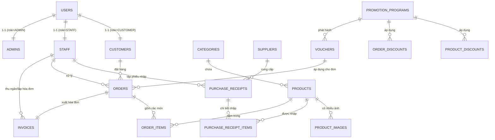

# KẾ HOẠCH THIẾT KẾ GIAO DIỆN VÀ CHỨC NĂNG BACKEND ADMIN (MÔ HÌNH MVC)
## HỆ THỐNG QUẢN LÝ CỬA HÀNG NỘI THẤT (FURNITURE MANAGEMENT SYSTEM)

---

## 1. TỔNG QUAN KIẾN TRÚC HỆ THỐNG THEO MÔ HÌNH MVC

Hệ thống quản trị (Admin Dashboard) được xây dựng theo chuẩn kiến trúc **MVC (Model - View - Controller)** kết hợp mô hình kiến trúc phân tầng chuyên nghiệp (Layered Architecture):

```
       +-------------------------------------------------------------+
       |                         VIEW (GIAO DIỆN)                    |
       |  - Admin Dashboard (React SPA / HTML5 + CSS3 + Bootstrap)  |
       |  - Components: Sidebar, DataTable, Forms, Charts, Modals    |
       +------------------------------+------------------------------+
                                      | HTTP Requests / RESTful APIs
                                      v
       +-------------------------------------------------------------+
       |                      CONTROLLER LAYER                       |
       |  - Spring Boot Admin Controllers (@RestController)          |
       |  - Request Validation (@Valid), Authentication & RBAC       |
       |  - Điều phối luồng và định dạng Response (DTO/JSON)         |
       +------------------------------+------------------------------+
                                      | Service Invocation
                                      v
       +-------------------------------------------------------------+
       |                   SERVICE LAYER (BUSINESS)                  |
       |  - Xử lý logic nghiệp vụ: Tính toán khuyến mãi, voucher    |
       |  - Quản lý giao dịch (@Transactional), kiểm tra ràng buộc    |
       +------------------------------+------------------------------+
                                      | ORM / Data Mapping
                                      v
       +-------------------------------------------------------------+
       |                      MODEL / DATA LAYER                     |
       |  - JPA Entities: Ánh xạ cấu trúc bảng PostgreSQL            |
       |  - Repositories (Spring Data JPA / Custom Native Query)     |
       |  - DTOs (Request / Response / ViewModels)                   |
       +-------------------------------------------------------------+
```

### 1.1. Bảng phân quyền người dùng (Role-Based Access Control - RBAC)

| Chức vụ (Role) | Mô tả quyền hạn trong hệ thống Admin |
| :--- | :--- |
| **ADMIN (Quản trị viên)** | Toàn quyền thao tác trên 10 module: Phân quyền tài khoản, quản lý nhân sự, xem toàn bộ báo cáo doanh thu tài chính, cấu hình khuyến mãi cao cấp, phê duyệt chiết khấu đặc biệt. |
| **STAFF (Nhân viên bán hàng / Quản lý kho)** | Xem & quản lý sản phẩm, tồn kho, xử lý đơn đặt hàng, tạo và in hóa đơn cho khách, quản lý thông tin khách hàng, xem danh sách khuyến mãi (không sửa xóa cấu hình hệ thống hoặc xem báo cáo lợi nhuận nội bộ). |

---

## 2. THIẾT KẾ CƠ SỞ DỮ LIỆU & BỔ SUNG ENTITY (MODEL)

Dựa trên cấu trúc database sẵn có (`database/sales.sql`), hệ thống hoàn thiện và bổ sung 2 thực thể mới quan trọng theo yêu cầu nghiệp vụ:
1. **`product_images`**: Cho phép một sản phẩm nội thất có nhiều góc chụp, hình ảnh phối cảnh thực tế (thay vì chỉ 1 ảnh duy nhất).
2. **`invoices`**: Quản lý xuất hóa đơn tài chính/hóa đơn bán lẻ từ đơn đặt hàng, lưu trữ lịch sử áp dụng voucher, thuế VAT, phương thức thanh toán.

### 2.1. Sơ đồ thực thể mở rộng (Entity Relationship Diagram)



### 2.2. DDL Bổ sung cho các bảng mới (PostgreSQL)

```sql
-- 1. Bảng quản lý nhiều hình ảnh cho sản phẩm nội thất
CREATE TABLE IF NOT EXISTS "product_images" (
    "id" BIGSERIAL PRIMARY KEY,
    "product_id" BIGINT NOT NULL REFERENCES "products"("id") ON DELETE CASCADE,
    "image_url" TEXT NOT NULL,
    "is_primary" BOOLEAN NOT NULL DEFAULT false,
    "display_order" INT NOT NULL DEFAULT 0,
    "created_at" TIMESTAMP NOT NULL DEFAULT CURRENT_TIMESTAMP
);
CREATE INDEX "idx_product_images_product" ON "product_images" ("product_id");

-- 2. Bảng quản lý Hóa đơn (Invoices)
CREATE TABLE IF NOT EXISTS "invoices" (
    "id" BIGSERIAL PRIMARY KEY,
    "invoice_code" VARCHAR(50) UNIQUE NOT NULL, -- VD: HD-20261027-001
    "order_id" BIGINT UNIQUE NOT NULL REFERENCES "orders"("id"),
    "customer_id" BIGINT NOT NULL REFERENCES "customers"("id"),
    "staff_id" BIGINT REFERENCES "staff"("id"),
    "subtotal_amount" NUMERIC(15,2) NOT NULL CHECK (subtotal_amount >= 0),
    "discount_amount" NUMERIC(15,2) NOT NULL DEFAULT 0 CHECK (discount_amount >= 0),
    "voucher_code" VARCHAR(50),
    "voucher_discount" NUMERIC(15,2) NOT NULL DEFAULT 0 CHECK (voucher_discount >= 0),
    "tax_amount" NUMERIC(15,2) NOT NULL DEFAULT 0 CHECK (tax_amount >= 0), -- VAT 8% hoặc 10%
    "final_amount" NUMERIC(15,2) NOT NULL CHECK (final_amount >= 0),
    "payment_method" VARCHAR(50) NOT NULL DEFAULT 'CASH' CHECK (payment_method IN ('CASH', 'BANK_TRANSFER', 'CREDIT_CARD', 'VNPAY', 'MOMO')),
    "payment_status" VARCHAR(30) NOT NULL DEFAULT 'PAID' CHECK (payment_status IN ('PENDING', 'PAID', 'REFUNDED')),
    "payment_date" TIMESTAMP NOT NULL DEFAULT CURRENT_TIMESTAMP,
    "notes" TEXT
);
CREATE INDEX "idx_invoices_order" ON "invoices" ("order_id");
CREATE INDEX "idx_invoices_customer" ON "invoices" ("customer_id");
CREATE INDEX "idx_invoices_date" ON "invoices" ("payment_date");
```

---

## 3. THIẾT KẾ GIAO DIỆN CHUNG CỦA BỘ ADMIN (VIEW ARCHITECTURE)

Giao diện Quản trị viên tuân thủ ngôn ngữ thiết kế hiện đại, phong cách **Modern Furniture & Interior (Tone màu gỗ ấm sậm Amber/Walnut kết hợp Slate Gray sang trọng)**:

```
+--------------------------------------------------------------------------------------------------+
|  LOGO FURNITURE ADMIN  |  [Search anything...]                  | Chuông (3) | Avatar (Admin) v  |
+------------------------+----------------------------------------+------------+-------------------+
| [SIDEBAR NAVIGATION]   | BREADCRUMB: Trang chủ > Quản lý sản phẩm                        [+ Thêm mới]  |
|                        +-------------------------------------------------------------------------+
| - Tổng quan (Dashboard)| [Bộ lọc tìm kiếm & Phân trang]                                          |
| - Tài khoản & Phân quyền| [Từ khóa...] [Chọn danh mục v] [Trạng thái v] [Khoảng giá]  [Nút Lọc]   |
| - Quách hàng           +-------------------------------------------------------------------------+
| - Nhân viên            | [BẢNG DỮ LIỆU CHÍNH (DATA TABLE)]                                       |
| - Loại nội thất        | [x] ID | Ảnh   | Tên sản phẩm | Danh mục | Giá bán | Tồn | T.Thái | Thao tác |
| - Sản phẩm & Album ảnh | [ ] 01 | [img] | Sofa Da Ý    | Sofa     | 18.5M   | 12  | [Hiện] | [Sửa][Xóa]|
| - Nhà cung cấp         | [ ] 02 | [img] | Bàn ăn Sồi   | Bàn ghế  | 12.0M   | 4*  | [Hiện] | [Sửa][Xóa]|
| - Khuyến mãi & Voucher +-------------------------------------------------------------------------+
| - Đơn đặt hàng (Orders)| Hiển thị 1 - 10 trên 150 mục                   [ < Trước ] [ 1 ] [ 2 ] [ Sau > ] |
| - Hóa đơn (Invoices)   +-------------------------------------------------------------------------+
| - Báo cáo & Thống kê   | FOOTER: Bản quyền © 2026 Nội Thất Cao Cấp - Phiên bản Admin v2.0         |
+------------------------+-------------------------------------------------------------------------+
```

### 3.1. Các thành phần giao diện chuẩn (Reusable UI Components)
1. **DataTable Grid**: Hỗ trợ sắp xếp cột (Sorting), tìm kiếm nhanh (Fast Search), phân trang (Pagination 10/25/50 items).
2. **Filter Toolbar**: Thanh lọc linh hoạt theo trạng thái, ngày tháng, danh mục.
3. **Action Button Groups**: Các nút hành động có icon và màu cảnh báo trực quan:
   - Thêm mới (Xanh lá / Primary Blue)
   - Xem chi tiết / Sửa (Vàng hổ phách / Info Cyan)
   - Khóa / Xóa (Đỏ Ruby cảnh báo, kèm Modal xác nhận chống xóa nhầm)
   - Xuất dữ liệu (Excel / PDF)
4. **Toast Notification & Alert**: Thông báo tức thì góc trên phải màn hình khi thao tác thành công hoặc gặp lỗi.
5. **Modal Dialogs**: Popup chuẩn cho thao tác Thêm / Sửa dữ liệu không cần tải lại trang.

---

## 4. KẾ HOẠCH CHI TIẾT 10 MODULE CHỨC NĂNG (GIAO DIỆN & BACKEND MVC)

---

### MODULE 1: QUẢN LÝ TÀI KHOẢN VÀ PHÂN QUYỀN (ACCOUNT & ROLE)

#### 1. Mục tiêu & Nghiệp vụ
- Quản lý tài khoản đăng nhập hệ thống (`users`), phân định vai trò: `ADMIN`, `STAFF`, `CUSTOMER`.
- Cho phép cấp phát tài khoản, đổi mật khẩu, kích hoạt hoặc tạm khóa tài khoản (`is_active = false`).
- Quy tắc an toàn: Không cho phép Quản trị viên tự khóa chính tài khoản đang đăng nhập.

#### 2. Thiết kế Giao diện (View)
- **Danh sách tài khoản**:
  - Cột: ID, Tên đăng nhập (Username), Vai trò (Badge màu: Đỏ - ADMIN, Lam - STAFF, Lục - CUSTOMER), Trạng thái (Hoạt động / Đang khóa), Ngày tạo, Thao tác.
  - Bộ lọc: Lọc theo Vai trò (Dropdown), Lọc theo Trạng thái (Tất cả / Đang hoạt động / Bị khóa), Tìm kiếm username.
- **Modal Thêm / Cập nhật tài khoản**:
  - Trường nhập: Username (bắt buộc, duy nhất), Mật khẩu (mã hóa tự động), Chọn Vai trò, Checkbox kích hoạt tài khoản.
- **Hộp thoại Đặt lại mật khẩu (Reset Password)**: Cho phép admin sinh mật khẩu ngẫu nhiên hoặc gán mật khẩu mới cho nhân viên khi quên.

#### 3. Thiết kế Backend (MVC)
- **Model / DTOs**:
  - `User.java`: Entity ánh xạ bảng `users`.
  - `CreateUserRequest.java`: Chứa `username`, `password`, `role`.
  - `UpdateUserStatusRequest.java`: Chứa `isActive`.
  - `UserResponseDto.java`: Thông tin trả về (loại bỏ trường password hash để bảo mật).
- **Repository**:
  - `UserRepository.java`: `findByUsername(String username)`, `findByRole(String role, Pageable pageable)`.
- **Service (`AdminUserService.java`)**:
  - `createUser(CreateUserRequest req)`: Hash mật khẩu bằng BCrypt trước khi lưu.
  - `toggleUserStatus(Long userId, boolean isActive)`: Kiểm tra không cho phép tự khóa tài khoản hiện tại.
  - `resetPassword(Long userId, String newPassword)`.
- **Controller Endpoints (`AdminUserController.java`)**:
  - `GET /api/admin/users`: Danh sách phân trang, tìm kiếm.
  - `POST /api/admin/users`: Tạo tài khoản mới.
  - `PUT /api/admin/users/{id}/status`: Khóa hoặc mở khóa tài khoản.
  - `PUT /api/admin/users/{id}/reset-password`: Đặt lại mật khẩu.

---

### MODULE 2: QUẢN LÝ KHÁCH HÀNG (CUSTOMER MANAGEMENT)

#### 1. Mục tiêu & Nghiệp vụ
- Quản lý hồ sơ khách hàng (`customers` liên kết `users`).
- Nắm bắt thông tin liên lạc, lịch sử mua hàng, tổng chi tiêu trọn đời (LTV - Lifetime Value).
- Hỗ trợ nhân viên chăm sóc khách hàng VIP hoặc liên hệ khi có phát sinh giao hàng nội thất.

#### 2. Thiết kế Giao diện (View)
- **Màn hình Danh sách Khách hàng**:
  - Bảng dữ liệu: Mã KH, Họ và tên, Email, Số điện thoại, Địa chỉ, Tổng số đơn hàng đã đặt, Tổng chi tiêu (VNĐ), Trạng thái tài khoản, Thao tác.
  - Bộ lọc: Tìm theo Tên / Số điện thoại / Email, Phân hạng khách hàng (VIP > 50 triệu, Thân thiết, Mới).
- **Màn hình Chi tiết Khách hàng (Customer Profile Drawer/Modal)**:
  - Tab 1: Thông tin cá nhân (Cho phép chỉnh sửa Email, SĐT, Địa chỉ giao hàng mặc định).
  - Tab 2: Lịch sử đơn hàng (Liệt kê tất cả đơn đã mua, mã đơn, ngày mua, tổng tiền, trạng thái giao nhận).
  - Tab 3: Giỏ hàng hiện tại (Xem khách đang quan tâm món đồ nào để hỗ trợ tư vấn).

#### 3. Thiết kế Backend (MVC)
- **Model / DTOs**:
  - `Customer.java`: Entity ánh xạ bảng `customers`.
  - `CustomerDetailResponseDto.java`: Gồm thông tin khách hàng, thống kê tổng đơn, tổng tiền đã chi.
  - `UpdateCustomerRequest.java`: Họ tên, SĐT, Địa chỉ.
- **Repository (`CustomerRepository.java`)**:
  - Query liên kết tính tổng chi tiêu: `SELECT c, count(o), sum(o.totalAmount) FROM Customer c LEFT JOIN Order o ON o.customer.id = c.id ...`
- **Service (`AdminCustomerService.java`)**:
  - `getAllCustomers(Pageable pageable, String search)`
  - `getCustomerDetail(Long customerId)`
  - `updateCustomerInfo(Long customerId, UpdateCustomerRequest req)`
- **Controller Endpoints (`AdminCustomerController.java`)**:
  - `GET /api/admin/customers`: Lấy danh sách khách hàng.
  - `GET /api/admin/customers/{id}`: Xem chi tiết và lịch sử đơn hàng.
  - `PUT /api/admin/customers/{id}`: Cập nhật thông tin khách hàng.

---

### MODULE 3: QUẢN LÝ NHÂN VIÊN (STAFF MANAGEMENT)

#### 1. Mục tiêu & Nghiệp vụ
- Quản lý danh sách nhân viên kinh doanh, thu ngân, kho (`staff`).
- Tự động tạo cặp tài khoản `users` (Role `STAFF`) đi kèm thông tin nhân sự `staff`.
- Phân công theo dõi đơn hàng và người phụ trách tạo phiếu nhập kho.

#### 2. Thiết kế Giao diện (View)
- **Danh sách Nhân viên**:
  - Bảng hiển thị: Mã NV, Ảnh đại diện, Họ tên, Email, Số điện thoại, Địa chỉ, Số đơn hàng đã xử lý, Ngày vào làm, Thao tác.
  - Hành động: Thêm nhân viên mới, Chỉnh sửa, Khóa quyền truy cập khi nhân viên nghỉ việc.
- **Form Thêm / Cập nhật Nhân viên**:
  - Thông tin tài khoản: Tên đăng nhập, Mật khẩu ban đầu.
  - Thông tin nhân viên: Họ và tên, Số điện thoại, Email công vụ, Địa chỉ thường trú.

#### 3. Thiết kế Backend (MVC)
- **Model / DTOs**:
  - `Staff.java`: Entity ánh xạ bảng `staff`.
  - `CreateStaffRequest.java`: DTO nhận đồng thời thông tin đăng nhập và hồ sơ cá nhân.
  - `StaffResponseDto.java`.
- **Repository (`StaffRepository.java`)**:
  - `findByEmail(String email)`, `findByPhone(String phone)`.
- **Service (`AdminStaffService.java`)**:
  - `createStaff(CreateStaffRequest req)`: Mở `@Transactional`, lưu vào bảng `users` (role `STAFF`), sau đó lưu vào bảng `staff`.
  - `updateStaff(Long staffId, UpdateStaffRequest req)`.
  - `deactivateStaff(Long staffId)`.
- **Controller Endpoints (`AdminStaffController.java`)**:
  - `GET /api/admin/staff`: Lấy danh sách nhân viên.
  - `POST /api/admin/staff`: Thêm mới nhân viên và khởi tạo tài khoản.
  - `PUT /api/admin/staff/{id}`: Chỉnh sửa thông tin nhân viên.
  - `DELETE /api/admin/staff/{id}`: Thu hồi quyền truy cập.

---

### MODULE 4: QUẢN LÝ LOẠI NỘI THẤT (FURNITURE CATEGORIES)

#### 1. Mục tiêu & Nghiệp vụ
- Phân loại sản phẩm nội thất: Phòng khách (Sofa, Kệ tivi), Phòng ngủ (Giường, Tủ quần áo), Bàn ăn, Bàn làm việc, Nội thất trang trí.
- Kiểm tra tính toàn vẹn dữ liệu: Không cho phép xóa danh mục nếu đang có sản phẩm thuộc danh mục đó trong kho.

#### 2. Thiết kế Giao diện (View)
- **Bảng Danh mục nội thất**:
  - Cột: ID, Tên danh mục, Mô tả ngắn, Số lượng sản phẩm hiện có, Thao tác (Sửa, Xóa).
  - Nút "+ Thêm loại nội thất" mở Modal nhanh.
- **Modal Thêm / Sửa Danh mục**:
  - Ô nhập Tên danh mục (Validate không được để trống, không trùng tên).
  - Textarea nhập Mô tả chi tiết.

#### 3. Thiết kế Backend (MVC)
- **Model / DTOs**:
  - `Category.java`: Entity ánh xạ bảng `categories`.
  - `CategoryDto.java`: ID, Tên, Mô tả, `productCount`.
- **Repository (`CategoryRepository.java`)**:
  - `findByName(String name)`, đếm số sản phẩm: `countProductsByCategoryId(Long categoryId)`.
- **Service (`AdminCategoryService.java`)**:
  - `createCategory(CategoryDto dto)`.
  - `updateCategory(Long id, CategoryDto dto)`.
  - `deleteCategory(Long id)`: Kiểm tra nếu `productCount > 0` thì chặn lại và báo lỗi thân thiện.
- **Controller Endpoints (`AdminCategoryController.java`)**:
  - `GET /api/admin/categories`: Danh sách danh mục kèm số lượng sản phẩm.
  - `POST /api/admin/categories`: Tạo danh mục mới.
  - `PUT /api/admin/categories/{id}`: Cập nhật danh mục.
  - `DELETE /api/admin/categories/{id}`: Xóa danh mục (nếu rỗng).

---

### MODULE 5: QUẢN LÝ SẢN PHẨM & HÌNH ẢNH SẢN PHẨM (PRODUCT & GALLERY)

#### 1. Mục tiêu & Nghiệp vụ
- Quản lý kho nội thất (`products`): Tên, loại nội thất, đơn vị tính (Cái, Bộ, Chiếc), giá bán, số lượng tồn kho, trạng thái bán (`is_active`).
- **Quản lý Album Hình ảnh (`product_images`)**: Đặc thù nội thất yêu cầu nhiều ảnh minh họa (ảnh phối cảnh 3D phòng, ảnh chất liệu gỗ/vải, ảnh kích thước chiều cao - rộng - sâu).
- Cảnh báo tồn kho thấp (Low stock alert khi số lượng < 5) để kịp thời liên hệ nhà cung cấp.

#### 2. Thiết kế Giao diện (View)
- **Danh sách Sản phẩm**:
  - Bảng dữ liệu: Ảnh đại diện, Tên sản phẩm, Danh mục, Đơn vị tính, Giá niêm yết (VNĐ), Số lượng tồn kho (Nếu < 5 hiển thị badge đỏ "Sắp hết hàng"), Trạng thái (Đang bán / Ngừng bán), Thao tác.
  - Bộ lọc nâng cao: Tìm kiếm tên, lọc theo Danh mục, lọc theo Tồn kho (Còn hàng / Hết hàng / Sắp hết), lọc khoảng giá.
- **Màn hình / Modal Thêm - Sửa Sản phẩm**:
  - **Phần 1: Thông tin cơ bản**: Tên sản phẩm, Danh mục (Dropdown), Đơn vị tính, Giá bán niêm yết, Số lượng khởi tạo ban đầu, Mô tả chi tiết (Hỗ trợ trình soạn thảo phong phú / Rich Text).
  - **Phần 2: Quản lý Thư viện Ảnh (Image Gallery Manager)**:
    - Khu vực kéo thả tải ảnh (Drag & Drop File Upload).
    - Danh sách các ảnh đã tải lên: Cho phép chọn 1 ảnh làm "Ảnh đại diện chính" (Primary Badge), đổi vị trí hiển thị, nút Xóa ảnh.
    - Hỗ trợ lưu trữ file cục bộ hoặc tải lên Cloudinary/S3/Supabase Storage.

#### 3. Thiết kế Backend (MVC)
- **Model / DTOs**:
  - `Product.java`: Entity ánh xạ `products`.
  - `ProductImage.java`: Entity ánh xạ `product_images`.
  - `ProductSaveRequest.java`: Tên, categoryId, giá, tồn kho, đơn vị, danh sách URL ảnh hoặc Multipart files.
  - `ProductDetailResponse.java`: Thông tin sản phẩm + danh sách ảnh liên quan.
- **Repository**:
  - `ProductRepository.java`: Hỗ trợ phân trang, lọc đa điều kiện (`JpaSpecificationExecutor`).
  - `ProductImageRepository.java`: `findByProductIdOrderByDisplayOrderAsc(Long productId)`.
- **Service (`AdminProductService.java`)**:
  - `saveProduct(ProductSaveRequest req, List<MultipartFile> files)`: Lưu sản phẩm, upload ảnh, tạo bản ghi `product_images`.
  - `updateStock(Long productId, int deltaQuantity)`: Cập nhật biến động kho.
  - `setPrimaryImage(Long productId, Long imageId)`: Đặt lại ảnh đại diện chính.
  - `deleteImage(Long imageId)`.
- **Controller Endpoints (`AdminProductController.java`)**:
  - `GET /api/admin/products`: Danh sách phân trang kèm bộ lọc.
  - `GET /api/admin/products/{id}`: Chi tiết sản phẩm kèm album ảnh.
  - `POST /api/admin/products`: Tạo mới sản phẩm (kèm upload ảnh).
  - `PUT /api/admin/products/{id}`: Sửa thông tin sản phẩm.
  - `DELETE /api/admin/products/{id}`: Ẩn sản phẩm (`is_active = false`) hoặc xóa mềm.
  - `POST /api/admin/products/{id}/images`: Tải thêm ảnh vào bộ sưu tập.
  - `DELETE /api/admin/products/{id}/images/{imageId}`: Xóa 1 ảnh cụ thể.

---

### MODULE 6: QUẢN LÝ NHÀ CUNG CẤP NỘI THẤT (SUPPLIERS & IMPORT)

#### 1. Mục tiêu & Nghiệp vụ
- Quản lý nhà cung ứng gỗ, vật liệu nội thất, xưởng gia công (`suppliers`).
- Lưu trữ thông tin: Tên nhà cung cấp, Người đại diện, Số điện thoại, Email, Địa chỉ xưởng/kho.
- Liên kết với chức năng Phiếu nhập kho (`purchase_receipts` và `purchase_receipt_items`) để cập nhật số lượng tồn vào kho sản phẩm.

#### 2. Thiết kế Giao diện (View)
- **Danh sách Nhà cung cấp**:
  - Cột: Mã NCC, Tên công ty/xưởng, Số điện thoại, Email, Địa chỉ, Số lần nhập hàng, Thao tác.
  - Thao tác: Thêm mới, Sửa, Lịch sử cung ứng.
- **Modal Thêm / Sửa Nhà cung cấp**:
  - Form nhập thông tin đầy đủ, kiểm tra định dạng email và số điện thoại hợp lệ.
- **Tab Lịch sử nhập hàng của Nhà cung cấp**:
  - Bảng danh sách phiếu nhập (`purchase_receipts`): Mã phiếu, Ngày nhập, Nhân viên thực hiện, Tổng tiền nhập, Trạng thái (PENDING / COMPLETED / CANCELLED).

#### 3. Thiết kế Backend (MVC)
- **Model / DTOs**:
  - `Supplier.java`: Entity ánh xạ bảng `suppliers`.
  - `SupplierDto.java`.
  - `PurchaseReceiptSummaryDto.java`.
- **Repository (`SupplierRepository.java`)**:
  - `findByNameContainingIgnoreCase(String name)`.
- **Service (`AdminSupplierService.java`)**:
  - `getAllSuppliers()`, `getSupplierById(Long id)`.
  - `createSupplier(SupplierDto dto)`, `updateSupplier(Long id, SupplierDto dto)`.
  - `getReceiptHistoryBySupplier(Long supplierId)`.
- **Controller Endpoints (`AdminSupplierController.java`)**:
  - `GET /api/admin/suppliers`: Lấy danh sách nhà cung cấp.
  - `POST /api/admin/suppliers`: Tạo nhà cung cấp mới.
  - `PUT /api/admin/suppliers/{id}`: Sửa thông tin nhà cung cấp.
  - `GET /api/admin/suppliers/{id}/receipts`: Xem lịch sử phiếu nhập hàng từ nhà cung cấp.

---

### MODULE 7: QUẢN LÝ CHƯƠNG TRÌNH KHUYẾN MÃI (PROMOTION PROGRAMS)

#### 1. Mục tiêu & Nghiệp vụ
Hệ thống khuyến mãi nội thất hỗ trợ 3 hình thức độc lập hoặc kết hợp trong 1 chiến dịch (`promotion_programs`):
1. **Giảm giá trực tiếp theo Sản phẩm (`product_discounts`)**: Áp dụng cho từng mặt hàng nội thất (VD: Giảm 15% cho Sofa góc chữ L).
2. **Chiết khấu theo Giá trị đơn hàng (`order_discounts`)**: Mua càng nhiều giảm càng sâu (VD: Đơn trên 20 triệu giảm 5%, đơn trên 50 triệu giảm 10%).
3. **Mã giảm giá / Phiếu quà tặng (`vouchers`)**: Tạo mã ký tự (VD: `NOITHATHE2026`, `VIPCUSTOMER`) với % giảm, giảm tối đa (cap amount), số lượng phát hành, giới hạn ngày áp dụng.
- Quản lý vòng đời chương trình: `DRAFT` (Bản nháp) -> `ACTIVE` (Đang chạy) -> `INACTIVE` (Đã kết thúc).

#### 2. Thiết kế Giao diện (View)
- **Màn hình Danh sách Chương trình khuyến mãi**:
  - Cột: Tên chương trình, Ngày bắt đầu, Ngày kết thúc, Trạng thái (Bản nháp / Đang áp dụng / Đã kết thúc), Số lượng voucher, Thao tác.
  - Nút chuyển nhanh trạng thái (Bật / Tắt chiến dịch).
- **Trang Thiết kế Chiến dịch Khuyến mãi (Chi tiết & Cấu hình)**:
  - **Khu vực 1: Thông tin chung**: Tên chương trình, Mô tả mục tiêu tiếp thị, Thời gian hiệu lực (Start Date - End Date).
  - **Khu vực 2: Giảm giá theo sản phẩm**: Chọn danh sách sản phẩm từ kho, nhập % chiết khấu cho từng món.
  - **Khu vực 3: Chiết khấu theo đơn hàng**: Tạo bậc giảm giá (Bậc 1: Từ 10.000.000đ giảm 5%, Bậc 2: Từ 30.000.000đ giảm 8%).
  - **Khu vực 4: Tạo & Quản lý Voucher**:
    - Nhập Mã code (hoặc nút bấm Tự động sinh mã ngẫu nhiên).
    - % giảm giá, Giảm tối đa (VNĐ), Giá trị đơn hàng tối thiểu để dùng mã.
    - Tổng số lượng phát hành, Thanh tiến trình hiển thị Số lượt đã dùng / Tổng số lượng.

#### 3. Thiết kế Backend (MVC)
- **Model / DTOs**:
  - `PromotionProgram.java`, `ProductDiscount.java`, `OrderDiscount.java`, `Voucher.java`.
  - `CreatePromotionRequest.java`: Chứa thông tin chương trình và danh sách chiết khấu/voucher đính kèm.
  - `PromotionDetailResponse.java`.
- **Repository**:
  - `PromotionProgramRepository.java`, `VoucherRepository.java`, `ProductDiscountRepository.java`.
- **Service (`AdminPromotionService.java`)**:
  - `createPromotion(CreatePromotionRequest req)`: Kiểm tra logic `endDate >= startDate`.
  - `updateProgramStatus(Long id, String status)`.
  - `generateVouchers(Long programId, CreateVoucherDto dto)`.
  - `getActivePromotions()`: Lọc các chương trình đang trong khoảng thời gian hiện tại.
- **Controller Endpoints (`AdminPromotionController.java`)**:
  - `GET /api/admin/promotions`: Danh sách chiến dịch khuyến mãi.
  - `POST /api/admin/promotions`: Tạo chiến dịch mới.
  - `GET /api/admin/promotions/{id}`: Xem chi tiết chiến dịch và các voucher bên trong.
  - `PUT /api/admin/promotions/{id}/status`: Kích hoạt hoặc tạm dừng chiến dịch.
  - `POST /api/admin/promotions/{id}/vouchers`: Cấp phát thêm mã voucher vào chương trình.

---

### MODULE 8: QUẢN LÝ ĐƠN ĐẶT HÀNG (ORDERS MANAGEMENT)

#### 1. Mục tiêu & Nghiệp vụ
- Xử lý toàn diện chu trình vòng đời đơn đặt hàng nội thất:
  `PENDING (Chờ xác nhận)` ➔ `CONFIRMED (Đã xác nhận & Điều phối)` ➔ `COMPLETED (Đã giao & Hoàn tất)` hoặc `CANCELLED (Đã hủy)`.
- Nhân viên bán hàng tiếp nhận đơn, kiểm tra số lượng tồn kho thực tế, liên hệ khách hàng để xác nhận địa chỉ và thời gian giao lắp nội thất.
- Ràng buộc: Khi đơn chuyển `CONFIRMED`, hệ thống bắt buộc phải gán `staff_id` phụ trách đơn hàng.
- Khi đơn hàng bị HỦY (`CANCELLED`), hệ thống tự động hoàn trả số lượng sản phẩm lại kho và hoàn lại số lượt sử dụng voucher (nếu có dùng voucher).

#### 2. Thiết kế Giao diện (View)
- **Bảng Danh sách Đơn hàng (Order Data Grid)**:
  - Cột: Mã đơn hàng (#ID), Khách hàng, Số điện thoại, Ngày đặt, Nhân viên tiếp nhận, Tổng tiền hàng, Giảm giá voucher, Thành tiền, Trạng thái (Pills màu riêng biệt: Vàng - Chờ duyệt, Lam - Đã duyệt, Lục - Hoàn thành, Xám/Đỏ - Hủy), Thao tác.
  - Thanh tab chuyển nhanh theo trạng thái: Tất cả (120) | Chờ xác nhận (15) | Đã xác nhận (20) | Hoàn thành (80) | Đã hủy (5).
- **Màn hình Chi tiết Đơn hàng (Order Detail View)**:
  - Khối 1: Thông tin người mua và địa chỉ nhận hàng giao lắp.
  - Khối 2: Danh sách sản phẩm trong đơn (Hình ảnh, Tên sản phẩm, Đơn giá, Số lượng, Thành tiền).
  - Khối 3: Bảng tính tiền chi tiết (Tổng phụ, Giảm giá khuyến mãi, Giảm giá voucher, Tổng thanh toán).
  - Khối 4: Khu vực hành động:
    - Nút `[Duyệt đơn hàng]`: Chuyển sang CONFIRMED và gán nhân viên phụ trách.
    - Nút `[Hủy đơn hàng]`: Mở modal yêu cầu nhập lý do hủy.
    - Nút `[Xuất Hóa Đơn]`: Điều hướng sang Module Hóa Đơn để thu ngân in hóa đơn và nhận thanh toán.
    - Nút `[In Phiếu Giao Hàng & Lắp Đặt Nội Thất]`.

#### 3. Thiết kế Backend (MVC)
- **Model / DTOs**:
  - `Order.java`, `OrderItem.java`.
  - `OrderStatusUpdateRequest.java`: Trạng thái mới, ghi chú.
  - `OrderDetailResponseDto.java`: Bao gồm danh sách items, thông tin khách hàng, voucher đã dùng.
- **Repository (`OrderRepository.java`)**:
  - `findByStatus(String status, Pageable pageable)`.
  - `findWithItemsById(Long orderId)`.
- **Service (`AdminOrderService.java`)**:
  - `confirmOrder(Long orderId, Long staffId)`: Kiểm tra tồn kho, chuyển trạng thái sang `CONFIRMED`.
  - `cancelOrder(Long orderId, String reason)`: Mở `@Transactional`, hoàn lại tồn kho `quantity` trong bảng `products`, giảm `used_quantity` của voucher (nếu có).
  - `completeOrder(Long orderId)`: Đánh dấu đơn hoàn tất khi khách đã nhận hàng và nghiệm thu lắp đặt.
- **Controller Endpoints (`AdminOrderController.java`)**:
  - `GET /api/admin/orders`: Lấy danh sách đơn hàng có phân trang & lọc trạng thái.
  - `GET /api/admin/orders/{id}`: Xem chi tiết 1 đơn hàng.
  - `PUT /api/admin/orders/{id}/confirm`: Xác nhận đơn hàng và gán nhân viên phụ trách.
  - `PUT /api/admin/orders/{id}/cancel`: Hủy đơn hàng và hoàn trả tài nguyên.
  - `PUT /api/admin/orders/{id}/complete`: Hoàn thành đơn hàng.

---

### MODULE 9: QUẢN LÝ HÓA ĐƠN & ÁP DỤNG KHUYẾN MÃI / VOUCHER (INVOICES & BILLING)

#### 1. Mục tiêu & Nghiệp vụ
- Lập hóa đơn chính thức (`invoices`) khi đơn hàng được thanh toán hoặc khi xuất xưởng giao khách.
- **Thuật toán tính toán chiết khấu & Áp dụng Khuyến mãi - Voucher chuẩn xác**:
  ```
  [1] Tổng tiền hàng gốc (Original Total) = Tổng(Số lượng x Đơn giá niêm yết)
  [2] Giảm giá sản phẩm (Product Discounts) = Tổng tiền các sản phẩm được giảm theo chương trình
  [3] Tạm tính sau giảm sản phẩm (Subtotal 1) = [1] - [2]
  [4] Chiết khấu theo đơn hàng (Order Discount) = Áp dụng % theo bậc chiết khấu đơn hàng nếu Subtotal 1 >= minimum_amount
  [5] Tạm tính sau chiết khấu đơn (Subtotal 2) = Subtotal 1 - [4]
  [6] Giảm giá Voucher = Tính theo % hoặc tiền cố định của Voucher:
      - Kiểm tra ngày hợp lệ (start_date <= hiện tại <= end_date)
      - Kiểm tra số lượng tồn của voucher (used_quantity < quantity)
      - Kiểm tra giá trị đơn tối thiểu (Subtotal 2 >= minimum_amount)
      - Tính: MIN(Subtotal 2 * discount_percent / 100, maximum_discount)
  [7] Tổng tiền sau giảm giá = Subtotal 2 - [6]
  [8] Thuế VAT (nếu có yêu cầu xuất hóa đơn đỏ) = [7] * 8% (hoặc 10%)
  [9] TỔNG THANH TOÁN HÓA ĐƠN (Final Amount) = [7] + [8]
  ```
- Cập nhật số lượt sử dụng voucher (`used_quantity = used_quantity + 1`).
- Hỗ trợ đa dạng phương thức thanh toán: Tiền mặt, Chuyển khoản QR ngân hàng (VietQR sinh tự động), Thẻ tín dụng, Cổng thanh toán (VNPay / Momo).
- In hóa đơn bán lẻ (Print Preview khổ giấy A4 hoặc K80) và gửi email hóa đơn điện tử cho khách.

#### 2. Thiết kế Giao diện (View)
- **Màn hình Danh sách Hóa đơn**:
  - Cột: Số hóa đơn (Mã HD: `HD-20261027-001`), Mã đơn hàng, Tên khách hàng, Ngày xuất, Phương thức thanh toán, Tổng tiền, Trạng thái thanh toán (Đã thanh toán / Chờ thanh toán / Hoàn tiền), Thao tác.
  - Bộ lọc: Lọc theo ngày xuất hóa đơn, Lọc theo Phương thức thanh toán, Tìm theo Mã HD hoặc Tên khách.
- **Màn hình Lập / Xem Hóa Đơn & Thanh Toán**:
  - Giao diện hóa đơn trực quan (Invoice Preview Layout):
    - Header: Tên cửa hàng nội thất, Địa chỉ showroom, Hotline, Mã số thuế.
    - Khách hàng: Tên, SĐT, Địa chỉ nhận hàng.
    - Bảng sản phẩm: STT, Mã SP, Tên sản phẩm nội thất, ĐVT, Số lượng, Đơn giá, Thành tiền.
    - Phần Khuyến mãi & Voucher:
      - Ô nhập mã Voucher trực tiếp (kèm nút "Áp dụng" nhanh).
      - Hiển thị dòng Giảm giá chương trình & Dòng Giảm giá Voucher màu xanh lá.
    - Phương thức thanh toán: Radio buttons (Tiền mặt / Chuyển khoản QR code tự sinh số tiền / Thẻ POS).
  - Nút bấm:
    - `[Xác nhận Thanh toán & Lưu Hóa đơn]`
    - `[In Hóa đơn (Print A4/K80)]`
    - `[Gửi Email Hóa Đơn PDF cho Khách]`

#### 3. Thiết kế Backend (MVC)
- **Model / DTOs**:
  - `Invoice.java`: Entity ánh xạ bảng `invoices`.
  - `CreateInvoiceRequest.java`: Chứa `orderId`, `paymentMethod`, `notes`, `voucherCode`.
  - `InvoiceResponseDto.java`: Toàn bộ thông tin chi tiết hóa đơn.
  - `CalculatePriceDto.java`: DTO nhận đầu vào và tính toán trước mức giá sau chiết khấu trước khi lưu.
- **Repository (`InvoiceRepository.java`)**:
  - `findByInvoiceCode(String code)`, `findByOrderId(Long orderId)`, `findBetweenDates(LocalDateTime from, LocalDateTime to)`.
- **Service (`AdminInvoiceService.java`)**:
  - `calculateOrderPricing(Long orderId, String voucherCode)`: Thực hiện thuật toán 9 bước trên mà không làm thay đổi DB (Preview giá).
  - `createInvoice(CreateInvoiceRequest req)`: Mở giao dịch `@Transactional`, áp dụng voucher, lưu hóa đơn, cập nhật trạng thái đơn hàng sang `COMPLETED`, tăng `used_quantity` của voucher.
  - `exportInvoicePdf(Long invoiceId)`: Sinh file PDF bằng iText hoặc JasperReports.
- **Controller Endpoints (`AdminInvoiceController.java`)**:
  - `GET /api/admin/invoices`: Danh sách hóa đơn có bộ lọc.
  - `GET /api/admin/invoices/{id}`: Chi tiết 1 hóa đơn.
  - `POST /api/admin/invoices/preview-calculation`: Xem trước số tiền sau khi áp dụng voucher/khuyến mãi.
  - `POST /api/admin/invoices`: Tạo và xuất hóa đơn chính thức.
  - `GET /api/admin/invoices/{id}/pdf`: Tải hoặc in hóa đơn dạng PDF.

---

### MODULE 10: THỐNG KÊ VÀ BÁO CÁO (ANALYTICS & REPORTING) - [✅ ĐÃ HOÀN THIỆN]

#### 1. Mục tiêu & Nghiệp vụ
- Cung cấp bức tranh toàn cảnh về hoạt động kinh doanh của showroom nội thất cho Ban Giám đốc và Quản trị viên.
- Thống kê doanh thu, lợi nhuận gộp (Doanh thu bán - Giá vốn nhập hàng), số lượng đơn hàng, tỷ lệ chuyển đổi.
- Báo cáo phân tích sản phẩm bán chạy, sản phẩm tồn kho ứ đọng, khách hàng có giá trị cao nhất.
- Báo cáo hiệu quả của các chiến dịch khuyến mãi và tỷ lệ sử dụng voucher.

#### 2. Thiết kế Giao diện (View)
- **Khu vực 1: Thẻ chỉ số tổng quan (Metric KPI Cards)**:
  - 💵 **Tổng doanh thu**: Doanh số trong kỳ chọn (Hôm nay / Tuần này / Tháng này / Quý này), % tăng trưởng so với kỳ trước.
  - 📦 **Đơn hàng mới**: Tổng số đơn phát sinh và tỷ lệ đơn đã hoàn thành thành công.
  - 🛋️ **Sản phẩm đã bán**: Tổng số món đồ nội thất đã xuất xưởng.
  - ⚠️ **Cảnh báo kho**: Số mặt hàng đang có tồn kho dưới định mức (< 5 cái).
- **Khu vực 2: Biểu đồ trực quan (Interactive Charts)**:
  - **Biểu đồ đường (Line/Area Chart)**: Xu hướng biến động doanh thu theo từng ngày trong tháng hoặc 12 tháng trong năm.
  - **Biểu đồ cột so sánh (Bar Chart)**: Doanh thu bán hàng so với Chi phí nhập hàng từ nhà cung cấp.
  - **Biểu đồ tròn (Donut Chart)**: Cơ cấu doanh thu theo từng Danh mục nội thất (Sofa chiếm bao nhiêu %, Giường ngủ, Bàn ăn,...).
- **Khu vực 3: Bảng xếp hạng & Báo cáo chi tiết**:
  - Top 5 sản phẩm nội thất bán chạy nhất (Best Sellers kèm hình ảnh và doanh số).
  - Top 5 sản phẩm tồn kho lâu nhất (Dead Stock cần xả hàng hoặc khuyến mãi).
  - Bảng thống kê hiệu quả mã giảm giá Voucher (Tên mã, Số lượt dùng, Tổng tiền chiết khấu đã tài trợ).
- **Khu vực 4: Công cụ Xuất báo cáo (Export Report Tool)**:
  - Chọn khoảng ngày tùy biến [Từ ngày] -> [Đến ngày].
  - Nút `[Xuất Báo Cáo Excel]` (.xlsx) và `[Xuất Báo Cáo Bán Hàng PDF]`.

#### 3. Thiết kế Backend (MVC)
- **Model / DTOs**:
  - `DashboardOverviewDto.java`: Doanh thu, số đơn, khách mới, sản phẩm sắp hết.
  - `RevenueChartDataDto.java`: Nhãn thời gian (Ngày/Tháng) và giá trị doanh thu tương ứng.
  - `TopSellingProductDto.java`: ID, Tên sản phẩm, Ảnh, Số lượng đã bán, Tổng tiền thu về.
  - `CategoryRevenueShareDto.java`: Tên danh mục, Doanh thu, Tỷ lệ phần trăm.
- **Repository (`StatisticsRepository.java` - Custom JPA / Native SQL)**:
  - Các câu truy vấn nhóm dữ liệu tối ưu:
    ```sql
    -- Thống kê doanh thu theo ngày
    SELECT date_trunc('day', payment_date) as report_date, SUM(final_amount) as total_revenue
    FROM invoices
    WHERE payment_status = 'PAID' AND payment_date BETWEEN :startDate AND :endDate
    GROUP BY report_date ORDER BY report_date ASC;

    -- Top 5 sản phẩm bán chạy nhất
    SELECT p.id, p.name, p.image_url, SUM(oi.quantity) as sold_qty, SUM(oi.amount) as revenue
    FROM order_items oi
    JOIN products p ON oi.product_id = p.id
    JOIN orders o ON oi.order_id = o.id
    WHERE o.status = 'COMPLETED'
    GROUP BY p.id, p.name, p.image_url
    ORDER BY sold_qty DESC LIMIT 5;
    ```
- **Service (`AdminStatisticsService.java`)**:
  - `getDashboardOverview()`: Tổng hợp số liệu KPI thời gian thực.
  - `getRevenueAnalytics(LocalDate fromDate, LocalDate toDate)`.
  - `getTopSellingProducts(int limit)`.
  - `exportExcelReport(LocalDate fromDate, LocalDate toDate)`: Dùng thư viện Apache POI để định dạng bảng tính đẹp mắt.
- **Controller Endpoints (`AdminStatisticsController.java`)**:
  - `GET /api/admin/statistics/overview`: Dữ liệu cho các thẻ KPI trên cùng.
  - `GET /api/admin/statistics/revenue-chart`: Dữ liệu vẽ biểu đồ doanh thu.
  - `GET /api/admin/statistics/category-share`: Dữ liệu biểu đồ tỷ trọng danh mục.
  - `GET /api/admin/statistics/top-products`: Danh sách sản phẩm bán chạy nhất.
  - `GET /api/admin/statistics/export-excel`: Tải file báo cáo Excel doanh thu bán hàng.

---

## 5. THIẾT KẾ CẤU TRÚC THƯ MỤC DỰ ÁN THEO CHUẨN MVC

Cấu trúc mã nguồn được phân chia rành mạch để dễ bảo trì và mở rộng:

```
furniture/
├── backend/
│   ├── src/main/java/furniture/
│   │   ├── Application.java
│   │   ├── config/                      # Cấu hình bảo mật, CORS, WebMvc, Swagger
│   │   │   ├── SecurityConfig.java
│   │   │   └── WebConfig.java
│   │   ├── admin/                       # Module Quản trị riêng biệt
│   │   │   ├── user/                    # Module 1: Tài khoản & Phân quyền
│   │   │   │   ├── controller/AdminUserController.java
│   │   │   │   ├── service/AdminUserService.java
│   │   │   │   └── dto/UserDto.java
│   │   │   ├── customer/                # Module 2: Khách hàng
│   │   │   │   ├── controller/AdminCustomerController.java
│   │   │   │   ├── service/AdminCustomerService.java
│   │   │   │   └── dto/CustomerDto.java
│   │   │   ├── staff/                   # Module 3: Nhân viên
│   │   │   │   ├── controller/AdminStaffController.java
│   │   │   │   ├── service/AdminStaffService.java
│   │   │   │   └── dto/StaffDto.java
│   │   │   ├── category/                # Module 4: Loại nội thất
│   │   │   │   ├── controller/AdminCategoryController.java
│   │   │   │   └── service/AdminCategoryService.java
│   │   │   ├── product/                 # Module 5: Sản phẩm & Ảnh
│   │   │   │   ├── controller/AdminProductController.java
│   │   │   │   ├── service/AdminProductService.java
│   │   │   │   └── dto/ProductSaveRequest.java
│   │   │   ├── supplier/                # Module 6: Nhà cung cấp & Nhập kho
│   │   │   │   ├── controller/AdminSupplierController.java
│   │   │   │   └── service/AdminSupplierService.java
│   │   │   ├── promotion/               # Module 7: Khuyến mãi & Voucher
│   │   │   │   ├── controller/AdminPromotionController.java
│   │   │   │   └── service/AdminPromotionService.java
│   │   │   ├── order/                   # Module 8: Đơn đặt hàng
│   │   │   │   ├── controller/AdminOrderController.java
│   │   │   │   └── service/AdminOrderService.java
│   │   │   ├── invoice/                 # Module 9: Hóa đơn & Áp dụng Voucher
│   │   │   │   ├── controller/AdminInvoiceController.java
│   │   │   │   └── service/AdminInvoiceService.java
│   │   │   └── statistics/              # Module 10: Thống kê & Báo cáo
│   │   │       ├── controller/AdminStatisticsController.java
│   │   │       └── service/AdminStatisticsService.java
│   │   ├── model/                       # JPA Entities
│   │   │   ├── User.java, Customer.java, Staff.java
│   │   │   ├── Category.java, Product.java, ProductImage.java
│   │   │   ├── Supplier.java, PurchaseReceipt.java
│   │   │   ├── PromotionProgram.java, ProductDiscount.java, Voucher.java
│   │   │   ├── Order.java, OrderItem.java, Invoice.java
│   │   ├── repository/                  # Spring Data JPA Repositories
│   │   │   ├── UserRepository.java, CustomerRepository.java, ...
│   │   └── util/                        # FileUploadUtil, PdfExportUtil, ExcelUtil
│   └── src/main/resources/
│       ├── application.properties
│       └── db/migration/                # Script khởi tạo bảng
└── frontend/                            # Giao diện Admin (React Vite SPA)
    ├── src/
    │   ├── layouts/
    │   │   ├── AdminLayout.jsx          # Khung viền Sidebar + Header + Breadcrumb
    │   │   ├── AdminSidebar.jsx
    │   │   └── AdminNavbar.jsx
    │   ├── pages/admin/
    │   │   ├── DashboardPage.jsx        # Module 10: Thống kê
    │   │   ├── UsersPage.jsx            # Module 1: Tài khoản
    │   │   ├── CustomersPage.jsx        # Module 2: Khách hàng
    │   │   ├── StaffPage.jsx            # Module 3: Nhân viên
    │   │   ├── CategoriesPage.jsx       # Module 4: Loại nội thất
    │   │   ├── ProductsPage.jsx         # Module 5: Sản phẩm
    │   │   ├── ProductFormPage.jsx      # Module 5: Thêm/Sửa & Upload album ảnh
    │   │   ├── SuppliersPage.jsx        # Module 6: Nhà cung cấp
    │   │   ├── PromotionsPage.jsx       # Module 7: Khuyến mãi & Voucher
    │   │   ├── OrdersPage.jsx           # Module 8: Đơn hàng
    │   │   ├── OrderDetailPage.jsx     # Module 8: Chi tiết đơn hàng
    │   │   └── InvoicesPage.jsx         # Module 9: Hóa đơn & In ấn
    │   ├── components/admin/
    │   │   ├── DataTable.jsx
    │   │   ├── ImageUploader.jsx
    │   │   ├── InvoicePrintTemplate.jsx
    │   │   └── StatWidget.jsx
    │   └── services/admin/              # Axios API calls
```

---

## 6. LỘ TRÌNH THỰC THI (ROADMAP & MILESTONES)

| Giai đoạn (Phase) | Nội dung công việc then chốt | Thời gian dự kiến | Sản phẩm đầu ra |
| :--- | :--- | :--- | :--- |
| **Giai đoạn 1** *(Nền tảng & Danh mục hàng hóa)* | - Bổ sung bảng `product_images` và `invoices` vào PostgreSQL.<br>- Dựng khung Admin Layout (Sidebar, Topbar, Routing).<br>- Hoàn thiện Module 1 (Tài khoản/Role) và Module 4 (Loại nội thất).<br>- Hoàn thiện Module 5 (Sản phẩm & Upload nhiều ảnh). | Tuần 1 - 2 | Admin đăng nhập được, CRUD danh mục, CRUD sản phẩm kèm tải album ảnh. |
| **Giai đoạn 2** *(Nhân sự, Khách hàng & Đối tác)* | - Triển khai Module 2 (Khách hàng) và Module 3 (Nhân viên).<br>- Triển khai Module 6 (Nhà cung cấp & Lịch sử nhập hàng). | Tuần 3 | Quản lý đầy đủ các đối tượng con người và đối tác trong chuỗi cung ứng. |
| **Giai đoạn 3** *(Khuyến mãi, Đơn hàng & Hóa đơn)* | - Triển khai Module 7 (Chương trình khuyến mãi & Sinh mã Voucher).<br>- Triển khai Module 8 (Quy trình duyệt, hủy, giao đơn hàng).<br>- Triển khai Module 9 (Lập hóa đơn, tính giảm giá tự động, in PDF). | Tuần 4 - 5 | Luồng bán hàng hoàn chỉnh từ đặt đơn ➔ duyệt đơn ➔ áp voucher ➔ xuất hóa đơn. |
| **Giai đoạn 4** *(Báo cáo thống kê & Nghiệm thu)* | - Triển khai Module 10 (Dashboard biểu đồ, Thống kê doanh thu).<br>- Xuất dữ liệu Excel/PDF.<br>- Kiểm thử tải, tối ưu truy vấn SQL, bảo mật RBAC. | Tuần 6 | Hệ thống Quản trị hoàn chỉnh sẵn sàng đưa vào vận hành thực tế. |

---

## 7. TIÊU CHÍ NGHIỆM THU & KIỂM THỬ (TESTING CHECKLIST)

- [ ] **Bảo mật**: Người dùng chưa đăng nhập hoặc có Role `CUSTOMER` bị chặn hoàn toàn khi truy cập các route `/api/admin/**`.
- [ ] **Ràng buộc dữ liệu**:
  - Không thể xóa danh mục nội thất khi vẫn còn sản phẩm đang thuộc danh mục đó.
  - Không thể chỉnh sửa chi tiết đơn hàng khi đơn đã ở trạng thái `COMPLETED` hoặc `CANCELLED`.
  - Mật khẩu lưu trữ bắt buộc được băm bằng thuật toán an toàn (`BCrypt`).
- [ ] **Khuyến mãi & Voucher**:
  - Mã voucher hết hạn hoặc hết lượt dùng (`used_quantity >= quantity`) lập tức báo lỗi khi áp dụng.
  - Mức giảm giá không được vượt quá giá trị `maximum_discount` đã cấu hình.
  - Khi đơn hàng bị hủy, số lượt dùng của voucher phải được hoàn trả lại cho hệ thống.
- [ ] **Hình ảnh**: Upload được nhiều định dạng ảnh phổ biến (PNG, JPG, WEBP), hiển thị đúng thứ tự và có gắn nhãn ảnh đại diện chính xác.
- [ ] **Giao diện**: Responsive trên màn hình máy tính (Desktop/Laptop) và máy tính bảng (Tablet), các thao tác xóa đều có popup cảnh báo xác nhận.
